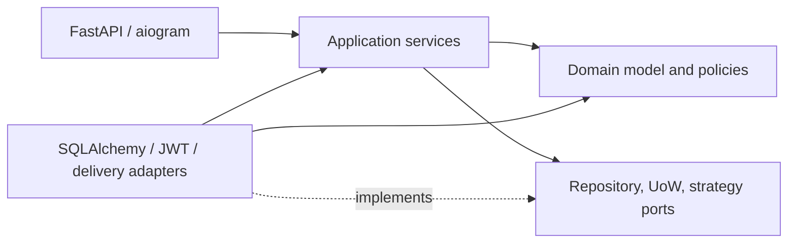
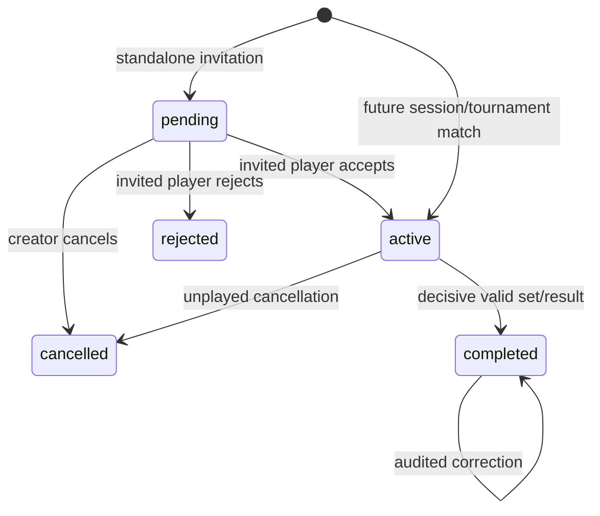

# Архитектура PingStats

## 1. Стиль и цели

PingStats — модульный монолит в одном процессе/репозитории с отдельным процессом aiogram-бота по мере реализации. Модули имеют собственную бизнес-модель и persistence-адаптеры, но используют одну PostgreSQL. Clean Architecture применяется прагматично: domain и application независимы от web/ORM; абстракции вводятся на границах, где необходимы замена, транзакционность или тестирование.

React Mini App расположен в том же репозитории, но является отдельным browser application. Он
зависит только от документированного `/api/v1` contract и не импортирует Python/domain-код.

Локальная топология до финального этапа и отдельного согласования: FastAPI запускается через Uvicorn, bot — через aiogram polling, PostgreSQL — локальный сервис, зависимости управляются uv. Docker, Docker Compose, Kubernetes, контейнерные артефакты и Redis запрещены без отдельного согласования.

## 2. Предлагаемая структура

```text
src/pingstats/
  app/                  # factories, lifespan, DI, middleware, router composition
  core/                 # settings, clock, ids, errors, DB/UoW contracts
  infrastructure/
    database/           # AsyncEngine, sessions, DeclarativeBase, SQLAlchemy UoW
  modules/
    auth/               # Telegram/development providers, JWT, current-user dependency
    users/              # domain/application/infrastructure/API/schemas
    friendships/        # requests, canonical mutual pairs, protected API
    matches/
    game_sessions/
    ratings/
    tournaments/
    statistics/
    leaderboard/
    notifications/
  bot/                  # aiogram delivery adapter
tests/
  unit/
  integration/
  api/
frontend/
  src/
    app/                # providers и routing composition
    api/                # typed Fetch client и endpoint adapters
    auth/               # in-memory auth state и Telegram bootstrap
    components/         # переиспользуемый UI shell
    hooks/              # UI helpers
    pages/              # route-level screens
    types/              # API и Telegram contracts
    styles/             # Tailwind entrypoint и Telegram-aware theme
```

Внутри сложного модуля допустимы `domain/`, `application/`, `infrastructure/`, `presentation/`. Для простого модуля эти папки не создаются механически.

## 3. Направление зависимостей



Domain не знает о FastAPI, SQLAlchemy и Telegram. HTTP-схемы не используются как доменные сущности. Межмодульная координация идёт через публичные application-сервисы и записанные в outbox события.

Frontend использует однонаправленный flow `page → auth/query state → typed API client → FastAPI`.
`ApiClient` добавляет Bearer header, нормализует ошибки, принимает `AbortSignal` и очищает сессию
при 401. JWT находится только в памяти экземпляра client/provider. TanStack Query владеет
server-state профиля, React Router — навигацией, UI не воспроизводит backend-инварианты.

## 4. Модули и ответственность

| Модуль | Ответственность | Основные application-сервисы |
|---|---|---|
| `auth` | auth providers, Telegram initData validation, JWT, current principal | `TelegramAuthService`, `DevLoginService`, `TelegramInitDataValidator`, `TokenService` |
| `users` | профиль, Telegram upsert, каталог игроков | `UpsertTelegramUser`, `GetProfile`, `ListPlayers` |
| `friendships` | заявки и симметричные связи | `Send/Accept/Reject/CancelRequest`, `RemoveFriend` |
| `matches` | единая модель 1×1, приглашение, правила счёта, ревизии | `MatchService`, `MatchResultWriter`, `ScoreValidator` |
| `game_sessions` | жизненный цикл, состав, очередь, session matches, последовательность, ротация | `GameSessionService`, `LoserRotatesStrategy` |
| `ratings` | Glicko-2, UTC-периоды, catch-up и пересчёт | `CloseDueRatingPeriods`, `RecalculateRatings`, `Glicko2Strategy` |
| `tournaments` | регистрация, rating seeding, сетка, walkover и продвижение | `Create/Join/StartTournament`, `RecordWalkover`, `AdvanceBracket`, `BracketStrategy` |
| `statistics` | перестраиваемые player/H2H projections | `ProjectMatchResult`, `RebuildStatistics`, queries |
| `leaderboard` | ранжированное чтение рейтинга | `GetLeaderboard` |
| `notifications` | outbox, предпочтения, доставка | `EnqueueNotification`, dispatcher |

`matches` владеет правилами счёта. `game_sessions` и `tournaments` вызывают `RecordResult` внутри общего UoW и реагируют на доменное событие `MatchResultRecorded`; собственных validators партий у них нет.

## 5. Транзакции и Unit of Work

Один command use case = один UoW = одна транзакция. Application-сервис получает репозитории через UoW, блокирует корень изменяемого агрегата, проверяет authorization/invariants, сохраняет изменения и outbox events, затем commit. Внешняя доставка выполняется после commit.

Один lazy `AsyncEngine` и один `async_sessionmaker` создаются на lifespan приложения и освобождаются при shutdown. Сеть не используется до первого SQL-запроса, поэтому недоступность PostgreSQL не блокирует запуск и обычный `/health`. Request-scoped `AsyncSession` никогда не выполняет неявный commit. `SqlAlchemyUnitOfWork` открывает транзакцию в async context manager, требует явного `commit`, откатывает незавершённую транзакцию при обычном выходе или исключении и всегда закрывает session. Репозитории не владеют транзакцией.

Ключевые блокировки:

- отправка/принятие/удаление дружбы: обе строки `users` блокируются в стабильном UUID-порядке;
  принятие дополнительно блокирует `friend_requests`, а DB indexes защищают pending/pair uniqueness;
- жизненный цикл/результат: `matches FOR UPDATE`; `version` отсекает stale-команды,
  а повтор идентичного полного результата распознаётся семантически;
- сессия: `game_sessions FOR UPDATE`, затем current `matches FOR UPDATE`, затем queue/participants;
  этот порядок используется для результата, отмены, завершения, join/leave и выдачи sequence;
  partial unique indexes запрещают два активных участия пользователя и два active-матча одной сессии;
- запуск/продвижение турнира: `tournaments`/целевой bracket node;
- закрытие рейтингового периода: PostgreSQL advisory lock плюс блокировка периода с уникальной published calculation version.

Для UI-редактирования агрегаты имеют `version` (optimistic lock). Deadlock предотвращается стабильным порядком UUID.

## 6. Жизненный цикл результата



`MatchService` проверяет автора, роль, статус и версию под блокировкой строки матча.
`ScoreValidator` единообразно валидирует партии и серию для пошаговой и полной записи.
Текущий итог нормализован в `match_sets`; `winner_id` всегда вычисляет сервер. Первоначальная
запись не создаёт audit revision; каждое исправление атомарно пишет полные previous/new JSONB-снимки
в `match_result_revisions` и заменяет current sets. Политика standalone: участник может исправлять до
`completed_at + 24h`. Причина необязательна, автор/время/оба снимка обязательны.

PS-006 не создаёт outbox и не обновляет rating/statistics: `match_sets`, `winner_id`, `completed_at`
и журнал revisions являются точкой интеграции будущих модулей. В PS-007.4 общая запись результата
вынесена в `MatchResultWriter`: standalone- и session-orchestrators используют один `ScoreValidator`,
одну модель sets и одно определение победителя. Writer не открывает UoW, не блокирует строки и не
выполняет commit. Прямые cancel/result/correction-команды `MatchService` принимают только
`standalone`; session match изменяется только контекстным workflow. Безопасное исправление session
result с учётом последующей истории остаётся отдельной задачей.

## 7. Свободная сессия и ротация

### Реализованная граница PS-007.2

`GameSessionService` реализует `create/get/list`, `join/leave`, `start/complete/cancel` и чтение
участников, не зависит от FastAPI и возвращает application DTO. Создание атомарно проверяет и
блокирует организатора, создаёт `pending`-сессию, первое участие и события `created`/`joined`.
Join допустим в `pending` и `active`; повторный join запрещён только пока участие активно, поэтому
выход и последующее присоединение создают новую строку и сохраняют историю.

Каждая изменяющая существующую сессию команда сначала блокирует `game_sessions FOR UPDATE`, затем
проверяет статус и права. Организатор запускает `pending`-сессию при наличии минимум двух активных
участников, завершает только `active`-сессию и отменяет только `pending`-сессию. Обычный leave
организатора запрещён. Порт `CurrentSessionMatchChecker` изолирует проверку незавершённого матча:
активный игрок не может выйти, а сессию нельзя завершить при наличии такого матча. SQLAlchemy-
адаптер уже читает общий агрегат `matches`, но PS-007.2 не создаёт session matches.

Все изменения участия и статуса пишут audit-событие в `game_session_queue_events` в той же
транзакции.

### Реализованная граница PS-007.3

`start_session` сортирует active participation по `(joined_at,id)`, сохраняет первых двух в
`game_session_current_pairs`, остальных — в `game_session_queue` с позициями от 1 и пишет
`queue_initialized`. Реальный match при этом не создаётся. Active join добавляется в waiting tail;
pending join не меняет очередь. Обычный leave играющего запрещён, waiting participant удаляется с
плотным пересчётом позиций.

Чистый `LoserRotatesStrategy` оставляет победителя, выбирает head waiting queue и перемещает
проигравшего в tail. При двух игроках waiting остаётся пустой. Доверенный workflow передаёт
server-side `result_id`; UNIQUE `(session_id,result_id)` гарантирует, что retry не выполнит вторую
ротацию. Операция выполняется под session row lock, атомарно заменяет pair/waiting state и добавляет
audit events с previous/current snapshots.

### Реализованная граница PS-007.4

`start_session` в том же UoW после инициализации pair/queue создаёт active `game_session` match
№1 без pending-приглашения. Настройки копируются из сессии; участниками матча становятся два
текущих игрока. Событие `match_started` и все lifecycle/queue changes фиксируются атомарно.
`sequence_number` вычисляется только под session row lock, монотонен и не переиспользуется после
отмены; unique `(game_session_id, sequence_number)` страхует схему.

Любой active participant сессии может записать одну партию или полный результат только current
match. Команда сначала блокирует session, затем match. `MatchResultWriter` валидирует и сохраняет
общий результат. Пока серия не завершена, pair/queue не меняются. При определении победителя
orchestrator в одной транзакции помечает `result_id=match.id` обработанным, применяет ротацию,
сохраняет очередь, пишет audit и создаёт следующий active match. Ошибка любого шага откатывает
результат, rotation ledger, очередь, события и successor match.

После результата под lock:

```text
if participant_count == 2:
    next_pair = (winner, loser)
    waiting = []
else:
    challenger = waiting.pop_front()
    waiting.push_back(loser)
    next_pair = (winner, challenger)
persist queue snapshot; mark result_id=completed_match.id;
allocate next sequence; create next active match; commit once
```

Инварианты: не более одного незавершённого матча на active-сессию; каждый active participant ровно один раз присутствует либо в текущей паре, либо в waiting; `sequence_number` монотонен; снимок очереди связан с причиной/матчем. Стратегия скрыта за `RotationStrategy`; MVP реализует только `loser_rotates`.

Отменить current match может organizer или один из двух игроков. Контекстный сервис помечает матч
`cancelled`, не создаёт sets/winner/rating/statistics, сохраняет восстановленную очередь и сразу
создаёт successor с новым номером. Для выхода играющего существует единая атомарная команда
`cancel_current_match_and_leave`: она отменяет матч и закрывает участие до создания successor,
поэтому бесконечной цепочки cancel/create нет. Если остаётся минимум два active participant,
формируется новая пара и следующий матч; если остаётся один, pair/queue очищаются, active-сессия
остаётся приостановленной без current match. Следующий join повторно инициализирует пару и создаёт
матч с очередным, а не повторным номером. Organizer обычным leave не пользуется.

Завершение active-сессии организатором атомарно отменяет незавершённый current match без поражения
и переводит сессию в `completed`; после этого active match нет, а вся история матчей и очереди сохранена.
UNIQUE ledger `(session_id,result_id)`, где `result_id` равен UUID завершённого матча, делает retry
завершения семантически идемпотентным: повтор не вращает очередь, не пишет события и не создаёт ещё
один successor.

PS-007.5 публикует этот application workflow через JWT-защищённый
`/api/v1/game-sessions`. Router преобразует Pydantic DTO и не содержит queue/match business rules.
Read-only история использует тот же `MatchRepository`, сортирует только по `sequence_number` и
проверяет участие через `GameSessionService`. PostgreSQL-backed HTTP acceptance подтверждает полный
трёхпользовательский flow, pause/resume, permissions, idempotent retry, rollback fault injection и
гонки result/cancel/complete/join/leave без второго active match или потерянного участника.

## 8. Турнир single elimination

`SingleEliminationBracketStrategy` строит полную сетку размера следующей степени двойки. MVP использует `RatingSeedingStrategy`: snapshot rating на момент запуска сортируется по убыванию, затем по меньшему RD и UUID; стандартные seed positions разводят сильнейших по секциям. BYE продвигаются детерминированно. Random/manual strategies являются будущими реализациями порта. Bracket node содержит два входных слота и ссылку на следующий node/slot. Матч создаётся, когда оба слота заполнены. Завершение сыгранного матча или walkover вызывает `AdvanceBracket`; уникальные constraints и lock узла исключают двойное продвижение. Самостоятельный leave разрешён до запуска; после запуска walkover оформляет только организатор.

Downstream match после исправления не удаляется. Если победитель поменялся до старта downstream match, отдельный correction workflow может заменить slot с аудитом; после записи downstream результата турнир `needs_review` до явного решения.

## 9. Glicko-2

`RatingStrategy.calculate(player_state, opponents, params)` — чистый детерминированный порт. Адаптер Glicko-2 конвертирует rating/RD в шкалу Glicko-2, вычисляет `v`, `delta`, новую volatility итерационным алгоритмом, затем `phi*`, `phi'`, `mu'` и обратное преобразование. Defaults — 1500/350/0.06 и `tau=0.5`, но все параметры приходят из validated settings и сохраняются со снимком расчёта. Draw технически поддерживается стратегией, хотя текущий матч ничьи запрещает.

Период — календарный интервал `[00:00, 00:00)` UTC. In-process scheduler стартует из FastAPI lifespan, при запуске и затем до ближайшей UTC-границы вызывает общий `CloseDueRatingPeriods`. Use case под PostgreSQL advisory lock создаёт отсутствующие периоды и закрывает их строго по порядку; поэтому рестарт и пропущенные дни безопасны. Development-only ручной endpoint вызывает тот же use case. Статус, уникальный интервал и `calculation_version` дают идемпотентность и защиту от повторной публикации; Celery/Redis не нужны.

Период закрывается из immutable input rows. Сначала рассчитываются все игроки из состояния на начало периода, затем результаты атомарно публикуются. Неактивные получают только рост RD. Сыгранные результаты и win/loss projections записываются немедленно, rating — только при publish. Correction помечает цепочку периодов stale; rebuild начинает с предыдущего valid period.

## 10. Авторизация

Все защищённые endpoints зависят от `get_current_user`, который проверяет JWT и загружает
пользователя из PostgreSQL. Auth provider меняется за этой границей.

- Application factory монтирует `POST /auth/dev-login` только при `APP_ENV=development`.
- Тело запроса отсутствует; identity — фиксированный `DEV_USER_ID`, имя `Test Player` и username
  `pingstats_dev`; PostgreSQL `ON CONFLICT` обеспечивает конкурентную идемпотентность.
- User create выполняет `users` service через UoW; JWT HS256 содержит только обязательные
  `sub=user.uuid`, `iat`, `exp`, `type=access` и не содержит доверенных профильных полей.
- Production router не монтируется, поэтому ответ 404. JWT secret, algorithm и TTL приходят из
  environment; token service отклоняет секрет короче 32 символов.
- `POST /auth/telegram` монтируется во всех окружениях и принимает только исходный `initData`.
  Validator строит secret key как HMAC-SHA256(`WebAppData`, bot token), вычисляет подпись над
  отсортированным data-check-string и сравнивает её constant-time операцией.
- После проверки подписи контролируются `auth_date`, конфигурируемый max age и 30-секундный
  допустимый clock skew. Только затем JSON `user` преобразуется в доверенные профильные поля.
- Telegram provider вызывает тот же users service/UoW и `TokenService`. PostgreSQL
  `INSERT ... ON CONFLICT (telegram_id) DO UPDATE` защищает конкурентную первую авторизацию,
  сохраняет UUID и остальные пользовательские данные, а `last_active_at` обновляется монотонно.
- `TELEGRAM_BOT_TOKEN` может отсутствовать при старте; в этом случае только Telegram-auth отвечает
  безопасным 503. Bot token, полный initData и JWT не попадают в логи или HTTP errors.

### 10.1. Mini App bootstrap

`index.html` подключает официальный `telegram-web-app.js` до React bundle. Frontend вызывает
`WebApp.ready()`/`expand()`, читает только raw `WebApp.initData` и передаёт его в
`POST /auth/telegram`; `initDataUnsafe` не является источником identity. После ответа JWT остаётся
в памяти, а профиль загружается через `GET /users/me`. Есть loading/error/retry states.

При отсутствии initData production не пытается имитировать Telegram и показывает инструкцию
открыть Mini App. Development build может динамически загрузить adapter фиксированного
`POST /auth/dev-login`; Vite полностью исключает этот adapter из production bundle. Vite dev proxy
направляет `/api` в локальный Uvicorn. UI использует Telegram theme variables, safe-area insets и
responsive mobile layout.

## 11. Read models, события и отказоустойчивость

Player statistics и H2H — проекции, которые можно перестроить из текущих результатов и журнала исправлений. Победы/поражения сыгранного матча обновляются сразу; отмена и walkover имеют отдельные события и не создают фиктивные sets. Для синхронно необходимого UI проекция обновляется в транзакции; тяжёлый rebuild выполняется отдельной локальной командой/worker в будущем. Outbox, когда он будет реализован отдельной задачей, обеспечит at-least-once обработку; consumers обязаны быть идемпотентными по `event_id`.

Notification module принимает только доменные/outbox-события: новая friend request, приглашение в match/session/tournament, старт турнира и назначение следующего tournament match. Бизнес-сервисы не импортируют aiogram; in-app store и будущая Telegram-доставка являются адаптерами.

Ошибки API имеют `code`, `message`, `details`, `request_id`. Логи структурированы и не содержат JWT, пароли турниров или Telegram initData. Метрики и tracing добавляются отдельной задачей без изменения domain.

## 12. Проверка архитектуры

- Unit: validators, lifecycle, rotation, bracket и Glicko-2 reference vectors.
- Integration: repositories, constraints, transaction rollback, locks, idempotency.
- API: permissions, validation, pagination, Telegram auth failures, 404 dev-login in production.
- Contract: события и OpenAPI.
