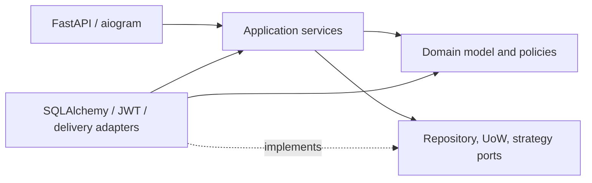
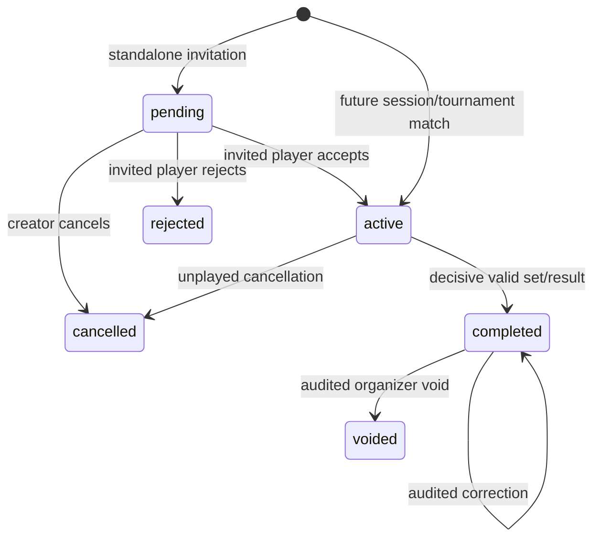

# Архитектура PingStats

## 1. Стиль и цели

PingStats — модульный монолит в одном процессе/репозитории с отдельным процессом aiogram-бота по мере реализации. Модули имеют собственную бизнес-модель и persistence-адаптеры, но используют одну PostgreSQL. Clean Architecture применяется прагматично: domain и application независимы от web/ORM; абстракции вводятся на границах, где необходимы замена, транзакционность или тестирование.

React Mini App расположен в том же репозитории, но является отдельным browser application. Он
зависит только от документированного `/api/v1` contract и не импортирует Python/domain-код.

Локальная топология до финального этапа и отдельного согласования: FastAPI запускается через Uvicorn, bot — через aiogram polling, PostgreSQL — локальный сервис, зависимости управляются uv. Docker, Docker Compose, Kubernetes, контейнерные артефакты и Redis запрещены без отдельного согласования.

## 2. Предлагаемая структура

```text
src/pingstats/
  app/                  # factories, lifespan, DI, middleware, router composition
  core/                 # settings, clock, ids, errors, DB/UoW contracts
  infrastructure/
    database/           # AsyncEngine, sessions, DeclarativeBase, SQLAlchemy UoW
  modules/
    auth/               # Telegram/development providers, JWT, current-user dependency
    users/              # domain/application/infrastructure/API/schemas
    friendships/        # requests, canonical mutual pairs, protected API
    matches/
    game_sessions/
    ratings/
    tournaments/
    statistics/
    leaderboard/
    notifications/
  bot/                  # aiogram delivery adapter
tests/
  unit/
  integration/
  api/
frontend/
  src/
    app/                # providers и routing composition
    api/                # typed Fetch client и endpoint adapters
    auth/               # in-memory auth state и Telegram bootstrap
    components/         # переиспользуемый UI shell
    hooks/              # UI helpers
    pages/              # route-level screens
    types/              # API и Telegram contracts
    styles/             # Tailwind entrypoint и Telegram-aware theme
```

Внутри сложного модуля допустимы `domain/`, `application/`, `infrastructure/`, `presentation/`. Для простого модуля эти папки не создаются механически.

## 3. Направление зависимостей



Domain не знает о FastAPI, SQLAlchemy и Telegram. HTTP-схемы не используются как доменные сущности. Межмодульная координация идёт через публичные application-сервисы и записанные в outbox события.

Frontend использует однонаправленный flow `page → auth/query state → typed API client → FastAPI`.
`ApiClient` добавляет Bearer header, нормализует ошибки, принимает `AbortSignal` и очищает сессию
при 401. JWT находится только в памяти экземпляра client/provider. TanStack Query владеет
server-state профиля, React Router — навигацией, UI не воспроизводит backend-инварианты.

## 4. Модули и ответственность

| Модуль | Ответственность | Основные application-сервисы |
|---|---|---|
| `auth` | auth providers, Telegram initData validation, JWT, current principal | `TelegramAuthService`, `DevLoginService`, `TelegramInitDataValidator`, `TokenService` |
| `users` | профиль, Telegram upsert, каталог игроков | `UpsertTelegramUser`, `GetProfile`, `ListPlayers` |
| `friendships` | заявки и симметричные связи | `Send/Accept/Reject/CancelRequest`, `RemoveFriend` |
| `matches` | единая модель 1×1, приглашение, правила счёта, ревизии | `MatchService`, `MatchResultWriter`, `ScoreValidator` |
| `game_sessions` | жизненный цикл, состав, очередь, session matches, последовательность, ротация | `GameSessionService`, `LoserRotatesStrategy` |
| `ratings` | Glicko-2, UTC-периоды, catch-up и пересчёт | `RatingPeriodCloser`, `RecalculateRatings`, `Glicko2Strategy` |
| `tournaments` | регистрация, rating seeding, сетка, walkover и продвижение | `Create/Join/StartTournament`, `RecordWalkover`, `AdvanceBracket`, `BracketStrategy` |
| `statistics` | перестраиваемые player/H2H projections | `ProjectMatchResult`, `RebuildStatistics`, queries |
| `leaderboard` | ранжированное чтение рейтинга | `LeaderboardService` |
| `notifications` | outbox, предпочтения, доставка | `EnqueueNotification`, dispatcher |

`matches` владеет правилами счёта. `game_sessions` и `tournaments` вызывают `RecordResult` внутри общего UoW и реагируют на доменное событие `MatchResultRecorded`; собственных validators партий у них нет.

## 5. Транзакции и Unit of Work

Один command use case = один UoW = одна транзакция. Application-сервис получает репозитории через UoW, блокирует корень изменяемого агрегата, проверяет authorization/invariants, сохраняет изменения и outbox events, затем commit. Внешняя доставка выполняется после commit.

`SqlAlchemyUnitOfWork` поддерживает keyed best-effort callbacks после commit. Callback регистрируется
до commit, дедуплицируется по ключу в пределах команды, очищается при rollback и запускается только
после завершения SQL-транзакции. Ошибка callback журналируется, но не меняет уже зафиксированный
результат команды. Этот механизм применяется к эфемерным UI invalidations; он не заменяет
transactional outbox для гарантированной доставки доменных событий.

Один lazy `AsyncEngine` и один `async_sessionmaker` создаются на lifespan приложения и освобождаются при shutdown. Сеть не используется до первого SQL-запроса, поэтому недоступность PostgreSQL не блокирует запуск и обычный `/health`. Request-scoped `AsyncSession` никогда не выполняет неявный commit. `SqlAlchemyUnitOfWork` открывает транзакцию в async context manager, требует явного `commit`, откатывает незавершённую транзакцию при обычном выходе или исключении и всегда закрывает session. Репозитории не владеют транзакцией.

Ключевые блокировки:

- отправка/принятие/удаление дружбы: обе строки `users` блокируются в стабильном UUID-порядке;
  принятие дополнительно блокирует `friend_requests`, а DB indexes защищают pending/pair uniqueness;
- жизненный цикл/результат: `matches FOR UPDATE`; `version` отсекает stale-команды,
  а повтор идентичного полного результата распознаётся семантически;
- сессия: `game_sessions FOR UPDATE`, затем current `matches FOR UPDATE`, затем queue/participants;
  этот порядок используется для результата, отмены, завершения, join/leave и выдачи sequence;
  partial unique indexes запрещают два активных участия пользователя и два active-матча одной сессии;
- запуск/продвижение турнира: `tournaments`/целевой bracket node;
- intake и закрытие рейтингового периода используют один PostgreSQL transaction-level advisory
  lock по UTC-дню; после него intake блокирует строку периода и пишет только в `open`, а closer под
  тем же lock переводит период в `calculating`. Уникальные interval/input keys и
  calculation version дополняют сериализацию на уровне БД.

Для UI-редактирования агрегаты имеют `version` (optimistic lock). Deadlock предотвращается стабильным порядком UUID.

## 6. Жизненный цикл результата



`MatchService` проверяет автора, роль, статус и версию под блокировкой строки матча.
`ScoreValidator` единообразно валидирует партии и серию для пошаговой и полной записи.
Текущий итог нормализован в `match_sets`; `winner_id` всегда вычисляет сервер. Первоначальная
запись не создаёт audit revision; каждое исправление атомарно пишет previous/new JSONB-снимки
в `match_result_revisions` и заменяет current sets. Standalone correction разрешён только
`created_by` до `completed_at + 24h`; число corrections не ограничено, участники и `completed_at`
immutable. Session correction выполняет только organizer без срока. Причина необязательна,
автор/время/тип операции/оба снимка обязательны для новых revisions.

Общая запись результата вынесена в `MatchResultWriter`: standalone- и session-orchestrators
используют один `ScoreValidator`, одну модель sets и одно определение победителя. Writer не открывает
UoW, не блокирует строки и не выполняет commit. После перехода ranked match в `completed`, но до
единственного `uow.commit()`, orchestrator вызывает `RatingMatchInputRecorder` через rating-
репозитории той же `AsyncSession`. Поэтому результат, session rotation и rating input либо
фиксируются вместе, либо вместе откатываются. Прямые cancel/result/correction-команды
`MatchService` принимают только `standalone`; session match изменяется только контекстным workflow.
Corrections и их rating rebuild остаются отдельным этапом.

## 7. Свободная сессия и ротация

### Реализованная граница PS-007.2

`GameSessionService` реализует `create/get/list`, `join/leave`, `start/complete/cancel` и чтение
участников, не зависит от FastAPI и возвращает application DTO. Создание атомарно проверяет и
блокирует организатора, создаёт `pending`-сессию, первое участие и события `created`/`joined`.
Join допустим в `pending` и `active`; повторный join запрещён только пока участие активно, поэтому
выход и последующее присоединение создают новую строку и сохраняют историю.

Каждая изменяющая существующую сессию команда сначала блокирует `game_sessions FOR UPDATE`, затем
проверяет статус и права. Организатор запускает `pending`-сессию при наличии минимум двух активных
участников, завершает только `active`-сессию и отменяет только `pending`-сессию. Обычный leave
организатора запрещён. Порт `CurrentSessionMatchChecker` изолирует проверку незавершённого матча:
активный игрок не может выйти, а сессию нельзя завершить при наличии такого матча. SQLAlchemy-
адаптер уже читает общий агрегат `matches`, но PS-007.2 не создаёт session matches.

Все изменения участия и статуса пишут audit-событие в `game_session_queue_events` в той же
транзакции.

### Реализованная граница PS-007.3

`start_session` сортирует active participation по `(joined_at,id)`, сохраняет первых двух в
`game_session_current_pairs`, остальных — в `game_session_queue` с позициями от 1 и пишет
`queue_initialized`. Реальный match при этом не создаётся. Active join добавляется в waiting tail;
pending join не меняет очередь. Обычный leave играющего запрещён, waiting participant удаляется с
плотным пересчётом позиций.

Чистый `LoserRotatesStrategy` оставляет победителя, выбирает head waiting queue и перемещает
проигравшего в tail. При двух игроках waiting остаётся пустой. Доверенный workflow передаёт
server-side `result_id`; UNIQUE `(session_id,result_id)` гарантирует, что retry не выполнит вторую
ротацию. Операция выполняется под session row lock, атомарно заменяет pair/waiting state и добавляет
audit events с previous/current snapshots.

### Реализованная граница PS-007.4

`start_session` в том же UoW после инициализации pair/queue создаёт active `game_session` match
№1 без pending-приглашения. Настройки копируются из сессии; участниками матча становятся два
текущих игрока. Событие `match_started` и все lifecycle/queue changes фиксируются атомарно.
`sequence_number` вычисляется только под session row lock, монотонен и не переиспользуется после
отмены; unique `(game_session_id, sequence_number)` страхует схему.

Любой active participant сессии может записать одну партию или полный результат только current
match. Команда сначала блокирует session, затем match. `MatchResultWriter` валидирует и сохраняет
общий результат. Пока серия не завершена, pair/queue не меняются. При определении победителя
orchestrator в одной транзакции помечает `result_id=match.id` обработанным, применяет ротацию,
сохраняет очередь, пишет audit и создаёт следующий active match. Ошибка любого шага откатывает
результат, rotation ledger, очередь, события и successor match.

После результата под lock:

```text
if participant_count == 2:
    next_pair = (winner, loser)
    waiting = []
else:
    challenger = waiting.pop_front()
    waiting.push_back(loser)
    next_pair = (winner, challenger)
persist queue snapshot; mark result_id=completed_match.id;
allocate next sequence; create next active match; commit once
```

Инварианты: не более одного незавершённого матча на active-сессию; каждый active participant ровно один раз присутствует либо в текущей паре, либо в waiting; `sequence_number` монотонен; снимок очереди связан с причиной/матчем. Стратегия скрыта за `RotationStrategy`; MVP реализует только `loser_rotates`.

Отменить current match может organizer или один из двух игроков. Контекстный сервис помечает матч
`cancelled`, не создаёт sets/winner/rating/statistics, сохраняет восстановленную очередь и сразу
создаёт successor с новым номером. Для выхода играющего существует единая атомарная команда
`cancel_current_match_and_leave`: она отменяет матч и закрывает участие до создания successor,
поэтому бесконечной цепочки cancel/create нет. Если остаётся минимум два active participant,
формируется новая пара и следующий матч; если остаётся один, pair/queue очищаются, active-сессия
остаётся приостановленной без current match. Следующий join повторно инициализирует пару и создаёт
матч с очередным, а не повторным номером. Organizer обычным leave не пользуется.

Отдельная команда `skip_current_match` не меняет семантику cancel. Под теми же session/match locks
она отменяет current match, применяет чистую domain-функцию skip к существующему queue state,
записывает `current_game_skipped` snapshot и создаёт ровно один successor. Один пропущенный игрок
уходит в хвост после waiting; при выборе обоих порядок хвоста детерминирован как player1, затем
player2. Stale/repeated request получает 409 и не вращает уже новую пару.

Завершение active-сессии организатором атомарно отменяет незавершённый current match без поражения
и переводит сессию в `completed`; после этого active match нет, а вся история матчей и очереди сохранена.
UNIQUE ledger `(session_id,result_id)`, где `result_id` равен UUID завершённого матча, делает retry
завершения семантически идемпотентным: повтор не вращает очередь, не пишет события и не создаёт ещё
один successor.

PS-007.5 публикует этот application workflow через JWT-защищённый
`/api/v1/game-sessions`. Router преобразует Pydantic DTO и не содержит queue/match business rules.
Read-only история использует тот же `MatchRepository`, сортирует только по `sequence_number` и
проверяет участие через `GameSessionService`. PostgreSQL-backed HTTP acceptance подтверждает полный
трёхпользовательский flow, pause/resume, permissions, idempotent retry, rollback fault injection и
гонки result/cancel/skip/complete/join/leave без второго active match или потерянного участника.

PS-009.3 добавляет read-only session statistics projection. Application-функция получает все
исторические profiles участников и только завершённые session matches с participants/sets, считает
результат без записи и детерминированно сортирует его. PostgreSQL adapter загружает matches,
participants/users и sets тремя bulk-запросами независимо от числа матчей; N+1 отсутствует.
Отдельный `/statistics` endpoint использует те же access checks. Общая session query invalidation
обновляет историю и лидерборд после результата, а cancel/skip не меняют проекцию.

PS-010.3.1 добавляет single-process realtime adapter без изменения session domain. JWT остаётся
только HTTP credential: защищённый `POST /game-sessions/{id}/ws-ticket` после обычной проверки
участия выдаёт opaque one-use ticket, связанный с user/session и коротким TTL. В памяти хранится
только SHA-256 digest. Browser передаёт ticket как отдельный `Sec-WebSocket-Protocol` value, поэтому
долгоживущий JWT и ticket не попадают в URL. Ticket атомарно consume-ится до handshake, после чего
доступ повторно проверяет `SqlAlchemyWebSocketSessionAuthorizer` внутри отдельной короткой session;
до `WebSocket.accept()` соединение с БД уже закрыто.

`WebSocketConnectionManager` хранит только socket/user grouping по session UUID, поддерживает
несколько клиентов, изолированный broadcast и удаление failed/disconnected sockets. Lifespan
закрывает все sockets и очищает tickets. Heartbeat обнаруживает разрыв на следующей receive/send
операции. Канал передаёт только invalidation metadata `session.updated`; frontend перечитывает REST.

PS-010.3.2 добавляет application-порт `SessionUpdatePublisher`. `GameSessionService` регистрирует
один keyed callback только в реально изменяющей ветке команды; `SqlAlchemyUnitOfWork` выполняет его
после успешного commit. Infrastructure adapter преобразует событие в существующий контракт и
вызывает `WebSocketConnectionManager.broadcast` только для UUID изменённой сессии. Публикуют create,
join, leave, start, complete/cancel session, incremental/full result, cancel match,
cancel-and-leave и skip one/both. Validation/conflict/rollback и семантический retry результата не
публикуют событие. Ошибка socket или broadcast не открывает новую транзакцию и не отменяет command.
In-memory store, publisher и manager корректны только для одного Uvicorn worker; multi-worker
deployment потребует Redis Pub/Sub либо другого согласованного межпроцессного broker и общего
one-use ticket store.

Production gate для текущего single-process adapter: один Uvicorn worker/process и Nginx proxy с
HTTP/1.1, WebSocket `Upgrade`/`Connection` forwarding и read timeout больше heartbeat-интервала.
Конфигурация Nginx/service manager находится вне репозитория и должна проверяться отдельно перед
deployment; кодовая конфигурация не может подтвердить соблюдение этого ограничения.

Uvicorn устанавливается без extra `standard`, поэтому WebSocket protocol не является его базовой
транзитивной зависимостью. Проект явно фиксирует runtime `websockets>=13.0`, соответствующий metadata
Uvicorn 0.54. Production использует `ws=auto`, который при текущей комбинации выбирает
`websockets-sansio`; unit deployment-guard загружает Uvicorn Config и требует ненулевой protocol
class. Production sync выполняется `uv sync --frozen --no-dev` строго по `uv.lock`.

PS-010.3.3 расширяет тот же ticket store отдельным scope `sessions_list` и тот же manager — отдельной
user-keyed картой соединений. `/game-sessions/ws` никогда не попадает в session-keyed map, поэтому
`session.updated` и `sessions.updated` не смешиваются. Application-порт `SessionsUpdatePublisher`
принимает только множество разрешённых user UUID и timestamp; WebSocket payload user/session IDs не
содержит. Аудитория вычисляется внутри исходной транзакции из существующей истории участия, которая
полностью совпадает с predicate REST `list_for_user`. Create, join, leave, start, complete, pending
cancel и cancel-and-leave регистрируют один отдельный keyed callback. Результаты и queue-only
операции не меняют текущие поля list card и list invalidation не публикуют.

Свободные игровые сессии сейчас не имеют public/open visibility mode: они видны только историческим
участникам. Поэтому глобальный list broadcast отсутствует; посторонний user connection не получает
даже факт активности закрытой сессии. Если публичный каталог появится как отдельное продуктовое
решение, его аудитория и канал потребуют самостоятельной visibility policy.

## 8. Турнир single elimination

`SingleEliminationBracketStrategy` строит полную сетку размера следующей степени двойки. MVP использует `RatingSeedingStrategy`: snapshot rating на момент запуска сортируется по убыванию, затем по меньшему RD и UUID; стандартные seed positions разводят сильнейших по секциям. BYE продвигаются детерминированно. Random/manual strategies являются будущими реализациями порта. Bracket node содержит два входных слота и ссылку на следующий node/slot. Матч создаётся, когда оба слота заполнены. Завершение сыгранного матча или walkover вызывает `AdvanceBracket`; уникальные constraints и lock узла исключают двойное продвижение. Самостоятельный leave разрешён до запуска; после запуска walkover оформляет только организатор.

Downstream match после исправления не удаляется. Если победитель поменялся до старта downstream match, отдельный correction workflow может заменить slot с аудитом; после записи downstream результата турнир `needs_review` до явного решения.

## 9. Glicko-2

`RatingStrategy.calculate(player_state, opponents, params)` — чистый детерминированный порт. Адаптер Glicko-2 конвертирует rating/RD в шкалу Glicko-2, вычисляет `v`, `delta`, новую volatility итерационным алгоритмом, затем `phi*`, `phi'`, `mu'` и обратное преобразование. Defaults — 1500/350/0.06 и `tau=0.5`, но все параметры приходят из validated settings и сохраняются со снимком расчёта. Draw технически поддерживается стратегией, хотя текущий матч ничьи запрещает.

Период — календарный интервал `[00:00, 00:00)` UTC и становится доступен для закрытия через пять
минут после конца, то есть в `00:05 UTC`. `RatingPeriodCloser` выбирает все сохранённые просроченные
`open` periods в хронологическом порядке и по одному переводит их в `calculating`. В PS-012.5 этот
статус означает запечатанную immutable input boundary; числовой расчёт и `published` не выполняются.
Повторный вызов видит non-open status и ничего не меняет.

Лёгкий in-process `RatingPeriodScheduler` принадлежит FastAPI lifespan. Он запускает rating
maintenance сразу после старта, а затем просыпается по локальному post-commit signal либо не реже
чем раз в 30 секунд для межпроцессного обнаружения rebuild jobs. В каждом цикле
`RatingRebuildOrchestrator` выполняется раньше normal `RatingWorkflowOrchestrator`; после cutover
обычный catch-up запускается немедленно. Суточное закрытие по-прежнему определяется `00:05 UTC`.
Инфраструктурные ошибки получают три ограниченных backoff retry, затем пяти минутный degraded
interval; business conflict переводит rebuild в durable `failed` без автоматического retry. На
shutdown task отменяется и ожидается. Каждый Uvicorn worker может запустить scheduler, но
дублирование исключено advisory locks, row locks и идемпотентностью этапов; отдельный leader service,
Celery и Redis не нужны. Scheduler отключён в testing.

Период закрывается из immutable input rows. Сначала рассчитываются все игроки из состояния на начало периода, затем результаты атомарно публикуются. Неактивные получают только рост RD. Сыгранные результаты и win/loss projections записываются немедленно, rating — только при publish. Correction помечает цепочку периодов stale; rebuild начинает с предыдущего valid period.

`RatingPeriodCalculator` PS-012.6.1 выполняет чистую application-оркестрацию одного периода со
статусом `calculating`, но ничего не сохраняет и не публикует. Он читает inputs текущей
`calculation_version` и исходные состояния исключительно из `rating_period_results` ближайшего
предыдущего сохранённого периода. Текущий `ratings` не используется: его snapshot может относиться к
более поздней публикации. Если предыдущий период существует, но его полный result set отсутствует
или его статус ещё не допускает историю, расчёт завершается controlled conflict; так более поздний
период нельзя вычислить вне очереди.

Для самого первого периода и нового участника применяется initial state из immutable parameter
snapshot текущего периода. Все матчи игрока преобразуются в один список opponents, причём rating/RD
каждого соперника берётся на начало того же периода; match order нормализуется и не создаёт
последовательных rating updates. Полный набор игроков предыдущего результата переносится дальше:
неактивные получают `games_count=0`, неизменные rating/volatility и Glicko-2 рост RD. Пользователь без
rating history и без текущего input не материализуется.

Calculation возвращает deterministic application DTO без UUID и timestamps. В PS-012.6.2.1
`RatingPeriodResultPersister` повторно использует calculator внутри того же UoW, берёт общий
period advisory lock и строку периода `FOR UPDATE`, затем сохраняет весь упорядоченный snapshot в
`rating_period_results` и устанавливает `rating_periods.calculated_version` одним commit. Маркер
равен `calculation_version` только после успешного сохранения всех строк; это также однозначно
помечает завершённый пустой период, у которого result rows отсутствуют.

Идемпотентный повтор пересчитывает deterministic DTO и сравнивает полный business snapshot с уже
сохранённым. Точное совпадение является no-op, несовпадение или строки без completion marker дают
controlled conflict и никогда не перезаписывают историю. Rollback удаляет и новые result rows, и
маркер. На этом этапе `ratings`, status периода и `published_at` не меняются; публикация остаётся
отдельной командой PS-012.6.2.2.

`RatingPeriodPublisher` PS-012.6.2.2 не запускает Glicko-2: источником служит immutable snapshot
`rating_period_results` версии, подтверждённой completion marker. Publisher под глобальным
transaction-level publication advisory lock затем берёт обычный period lock и строку периода
`FOR UPDATE`. Глобальный lock сериализует публикацию разных периодов, которые могут обновлять одни
и те же строки `ratings`; period lock одновременно исключает гонку с persistence.

До записи проверяются status/version/marker, ближайший предыдущий существующий период, отсутствие
уже опубликованного более позднего периода, полнота active users относительно inputs и перенос всех
пользователей предыдущего snapshot. Для существующего current rating его `as_of_period_id` и
rating/RD/volatility обязаны совпасть с начальным состоянием result. Затем все current ratings,
накопительный `rated_matches_count`, `status=published` и UTC `published_at` фиксируются одним commit.
Ошибка откатывает весь набор. Повтор той же опубликованной версии возвращает период без commit и не
меняет ratings или `published_at`; несовместимая версия/история является controlled conflict.

`RatingWorkflowOrchestrator` PS-012.6.3 сначала вызывает closer, затем одним коротким read-UoW
получает все `calculating` periods в порядке `starts_at`. Для каждого периода он перечитывает state:
без актуального marker вызывает persister, с marker — publisher, после каждого отдельного commit
снова читает период. Уже `published` пропускается. Ошибка раннего периода немедленно останавливает
цикл, поэтому поздние периоды не рассчитываются и не публикуются. Успешные предыдущие транзакции не
откатываются. Конкурентный worker, завершивший тот же этап первым, распознаётся по повторно прочитанным
status/marker и считается нормальным прогрессом, а не повреждением.

PS-012.10 добавляет внутренний `RatingHistoricalBackfill`. Он под global publication advisory lock
keyset-сканирует матчи по `(completed_at, id)`, загружая match/participants/current sets/latest
revision пакетно. В eligibility входят только `completed + ranked`; остальные строки с
`completed_at` учитываются как skipped. Intake использует обычный `RatingMatchInputRecorder`, поэтому
новые periods получают algorithm version `2`, UTC-границы, fingerprint и ссылку на актуальную
revision. Все новые inputs одного запуска фиксируются одной транзакцией: конфликт в позднем матче
откатывает и более ранние изменения.

Перед intake проверяется persistent rebuild barrier. Lock order совпадает с correction/publisher:
global publication → period advisory → period row. Отсутствующий период нельзя вставить перед уже
published history; missing/mismatched input sealed периода даёт controlled conflict. Идентичный
input любой стадии является idempotent skip. После commit `RatingWorkflowOrchestrator.run_periods`
закрывает, рассчитывает и публикует только затронутые непустые периоды в хронологическом порядке;
его обычные stages, completion markers и locks обеспечивают восстановление после прерывания.
Dry-run проходит те же проверки и блокировки, но не записывает данные.
Backfill не форсирует закрытие текущих UTC-суток: input сохраняется в `open` period, а
calculator/publisher не запускаются до штатного close deadline. Явный integration test также
фиксирует fail-closed поведение для отсутствующего периода перед уже published horizon.

### 9.1 Corrections и rebuild

С PS-012.7.5 correction разделён по policy: standalone исправляет только
`matches.created_by` в течение 24 часов, session match — только organizer сессии без срока, включая
completed session. `completed_at` и участники immutable. Session correction не запускает ротацию,
не меняет очередь, пары, последующие матчи или status сессии. Match revision и rating correction
revision создаётся в той же транзакции, что и mutation match. Общий application-компонент
`MatchResultEditor` не зависит от delivery и переиспользуется standalone/session services.

До первой publication `RatingCorrectionCoordinator` под publication/period locks назначает
монотонно увеличенную `calculation_version`, копирует полный immutable input snapshot и заменяет в
нём исправленный match либо исключает voided match; старые inputs/results остаются. Completion
marker сбрасывается, поэтому обычный workflow пересчитывает период. Аннулированный completed match имеет
отдельное доменное состояние `voided`, отличное от cancellation незавершённого матча, и отсутствовать
в новом input snapshot. Void разрешён organizer без ограничения времени для standalone/session,
включая completed session. Если исходный rating input отсутствует, coordinator выдаёт controlled
conflict, а общая транзакция откатывает match mutation, revision и rating coordination.

После publication coordinator создаёт persistent recalculation request и один активный
`rating_rebuild_job`, фиксирует закрытый horizon существующих non-open periods и резервирует для
каждого новую, никогда не переиспользуемую target version. Published snapshots и current ratings не
изменяются. Новая correction переводит прежний active/failed job в `superseded`, переносит его
незавершённые requests и создаёт новую ветку от самого раннего affected period.
`published_version` продолжает указывать на пользовательскую ветку, пока новые монотонные shadow
versions последовательно готовятся от самого раннего affected period. `rating_rebuild_periods`
хранит per-period checkpoints. Horizon не включает open periods; intake новых матчей и closer
продолжают работать. Persister и publisher проверяют persistent barrier после global publication
lock и period row lock; workflow останавливает текущий проход без интенсивного retry. `failed` job
удерживает barrier. Старые shadow snapshots остаются immutable.

С PS-012.7.7 `RatingRebuildExecutor` последовательно обрабатывает checkpoints в хронологическом
порядке. Для target version он перечитывает текущее состояние каждого source match, связывает input
с последней revision, исключает `voided` и не меняет source snapshots. Первый shadow period берёт
ближайшую предыдущую active `published_version`, каждый следующий — target results предыдущего
checkpoint. Тот же calculator применяет Glicko-2 и calendar inactivity. Inputs, полный result
snapshot, `calculated_version` и checkpoint `ready` фиксируются одной транзакцией на период; после
готовности всех checkpoints job переходит в `ready`. Повторный запуск сравнивает immutable snapshots
и продолжает с первого незавершённого checkpoint. Global publication/job/period locks защищают от
параллельного executor и supersede. `ratings`, `published_version` и `published_at` до cutover не
изменяются, а persistent barrier остаётся активным.

Каждый shadow period имеет отдельную транзакцию подготовки inputs и сохранения results. С
PS-012.7.8 `RatingRebuildCutover` под global publication lock блокирует job, periods хронологически
и current ratings по UUID. До mutation он проверяет active job, полный ready horizon, target
completion markers и отсутствие незакреплённых corrections. Одним commit сервис переключает
`published_version`, восстанавливает cumulative `rated_matches_count` из versioned inputs,
обновляет полный current snapshot, завершает requests/job и фиксирует cutover time. Игрок,
потерявший после аннулирования всю rated history, удаляется из current `ratings`. Для ранее
published periods первоначальный `published_at` сохраняется; ранее unpublished periods получают
время первой публикации при cutover. Ошибка откатывает также промежуточный `activating`, поэтому
старая ветка и barrier сохраняются. Повтор completed job идемпотентен. Redis, Celery и broker не
используются.

С PS-012.7.9 `RatingRebuildOrchestrator` автоматически восстанавливает `pending/preparing`, запускает
cutover для `ready`, пропускает завершённые/superseded jobs и оставляет `failed` как persistent
barrier. Expected application conflicts сохраняются как `failed` с `error_code`; инфраструктурные
исключения остаются scheduler retry. Ручное восстановление выполняется внутренней командой
`uv run python -m pingstats.modules.ratings.infrastructure.retry_rebuild <job_uuid>`: она переводит
только активный failed job обратно в `preparing`, продолжает durable checkpoints и после cutover
возобновляет normal workflow. Correction регистрирует process-local wake-up только after commit;
если сигнал потерян или job создан другим worker, PostgreSQL discovery подхватывает его в следующем
периодическом цикле.

PS-012.7.10 подтверждает сквозной lifecycle corrections/rebuild: standalone и session revisions,
неопубликованные versioned inputs, published shadow rebuild, supersede, atomic cutover, calendar
inactivity, restart/manual recovery и последующее продолжение normal workflow. PostgreSQL
concurrency suite проверяет сериализацию correction, intake, closer, persistence/publication,
executor и cutover. Старые active snapshots доступны до commit cutover, а rollback/failed job не
освобождает barrier.

Calendar inactivity реализован в PS-012.7.3 и вычисляется по UTC-границам, а не по количеству period
rows или времени запуска scheduler. `missing_periods = UTC-date(current.starts_at) -
UTC-date(previous.ends_at)`. Calculator сначала строит внутренние working states ранее рейтингованных
игроков после этих inactivity transitions, затем ровно один раз выполняет обычный расчёт текущего
периода. Те же working states используются для соперников, поэтому результаты внутри периода остаются
одновременными. Новый игрок получает initial state непосредственно в первом периоде участия.

Persisted `rating_before`, `rd_before`, `volatility_before` остаются исходным состоянием предыдущего
snapshot, а не промежуточным working state. Поэтому publisher продолжает сравнивать их с current
`ratings`; `*_after` уже включает календарный gap и текущий period step. Algorithm version `1`
сохраняет прежнюю sparse-семантику для воспроизводимости существующих snapshots, version `2`
создаётся для новых periods и включает calendar inactivity. Пустые period/result rows не создаются,
существующая история автоматически не пересчитывается. Domain-операция многошаговой inactivity
переиспользуема shadow rebuild и будущим backfill.

С PS-012.8 read-only `RatingQueryService` возвращает current rating и paginated history только из
active published branch. Infrastructure query adapter соединяет `rating_period_results` с
`rating_periods.published_version`; shadow snapshots исключены на уровне SQL. Перед чтением current
state или страницы history adapter берёт transaction-level shared advisory publication lock, а
cutover использует соответствующий exclusive lock. Поэтому один HTTP response видит целиком старую
либо целиком новую ветку, но не промежуточное состояние atomic cutover.

Stored `rd` остаётся воспроизводимым значением последнего опубликованного snapshot. Отдельное
`effective_rd` вычисляется без записи тем же `Glicko2Strategy.advance_inactivity`: один шаг за каждую
полностью завершённую UTC-сутки после `as_of_period_ends_at`, без текущих незавершённых суток.
Response также содержит `inactivity_periods`, исходный `rd` и границу snapshot, поэтому projection
не смешивается с published state. Игрок без истории не получает автоматически созданный rating.

Модуль `leaderboard` является отдельным read model поверх публичного ratings application API.
`SqlAlchemyLeaderboardRepository` под тем же shared publication lock строит оконную
`row_number()` по rating DESC, RD ASC, rated matches DESC и UUID ASC. PostgreSQL выполняет
ранжирование и offset/limit; page query сразу соединяет пользователя, current rating и его
published period, поэтому N+1 отсутствует. Второй metadata query возвращает total и позицию
авторизованного пользователя независимо от страницы. `LeaderboardService` переиспользует
`RatingQueryService.project_current`, поэтому effective RD не имеет отдельной реализации.

PS-012.7.4 добавляет durable rebuild infrastructure без запуска rebuild. `rating_periods` хранит
три независимых указателя: `published_version` выбирает активную историю, `calculation_version`
указывает готовящуюся версию, `calculated_version` подтверждает полный snapshot. Normal publisher
устанавливает active version тем же commit, которым обновляет current ratings и status периода;
calculator и publisher читают предыдущий опубликованный snapshot только через `published_version`.

`rating_rebuild_jobs` хранит глобальный rebuild horizon и checkpoint состояния job. PostgreSQL
partial unique index допускает только один job в `pending/preparing/ready/activating/failed`;
`failed` намеренно продолжает удерживать persistent barrier. Только `completed` и `superseded`
освобождают singleton. `rating_rebuild_periods` хранит ordered per-period checkpoint и уникальную
пару `(period_id,target_version)`, поэтому shadow version нельзя повторно назначить другому job.
Recalculation request имеет nullable current assignment `rebuild_job_id`; immutable match revision и
старые jobs/checkpoints сохраняют аудит, но отдельная append-only история переназначений пока не
создана. Репозитории читают barrier и блокируют job/checkpoint `FOR UPDATE`; normal persister и
publisher применяют barrier, а scheduler автоматически продолжает rebuild до безопасного cutover.

Порядок реализации утверждён с зависимостями: PS-012.7.3 Calendar Inactivity → PS-012.7.4 Rebuild
Infrastructure → PS-012.7.5 Match Corrections → PS-012.7.6 Rebuild Coordination → PS-012.7.7 Shadow
Calculation → PS-012.7.8 Atomic Cutover → PS-012.7.9 Rebuild Orchestration → PS-012.7.10 Integration
& E2E. Порядок менять не требуется: математика и durable schema предшествуют producer corrections,
coordination предшествует shadow writes, а orchestration начинается после безопасного cutover.

`RatingMatchInputRecorder` регистрирует факт сразу при завершении standalone/session match. Eligibility:
`status=completed`, `is_ranked=true`, два разных участника, winner среди них и непустой валидный
результат; active, cancelled и unranked matches пропускаются. Период выбирается исключительно по
aware `completed_at` как UTC-интервал `[00:00, 00:00)`. Recorder берёт общий period advisory lock,
создаёт отсутствующий `open` period со snapshot параметров либо блокирует существующий `FOR UPDATE`,
после чего сохраняет immutable input. В `calculating`, `published`, `stale` или `failed` период
новый input не принимается.

Closer использует тот же lock key и порядок `period advisory lock → rating_period FOR UPDATE`, что
и intake. Если intake получил lock первым, его input фиксируется до запечатывания. Если closer
получил lock первым, статус становится `calculating`, а ожидающий intake получает controlled conflict
и вся match/session транзакция откатывается. Пять минут являются grace window для завершений около
UTC-границы; решение всегда сравнивает timezone-aware значения после преобразования в UTC.

Idempotency key в БД — `(period_id, calculation_version, match_id)`. Канонический SHA-256
fingerprint включает идентификатор матча, упорядоченных участников и партий, winner и UTC
`completed_at`. Повтор с теми же `source_match_version` и fingerprint является no-op; расхождение
возвращает контролируемый conflict и не перезаписывает историю. Initial intake не создаёт отдельную
транзакцию, after-commit callback или числовой rating.

Persistence ratings реализован отдельным infrastructure adapter поверх общей `AsyncSession` и
`SqlAlchemyUnitOfWork`. `RatingRepository` хранит только последний опубликованный snapshot,
`RatingPeriodRepository` — UTC-периоды и optimistic versions, `RatingInputRepository` — immutable
match snapshots для каждой calculation version, `RatingResultRepository` — period-level историю,
`RatingRecalculationRepository` — идемпотентные requests от correction revision. Репозитории не
открывают и не commit-ят собственные транзакции. Схема и репозитории не запускают Glicko-2,
пересчёт: автоматическая оркестрация существующих closer/persister/publisher не переносит
бизнес-логику в scheduler.

## 10. Авторизация

Все защищённые endpoints зависят от `get_current_user`, который проверяет JWT и загружает
пользователя из PostgreSQL. Auth provider меняется за этой границей.

- Application factory монтирует `POST /auth/dev-login` только при `APP_ENV=development`.
- Тело запроса отсутствует; identity — фиксированный `DEV_USER_ID`, имя `Test Player` и username
  `pingstats_dev`; PostgreSQL `ON CONFLICT` обеспечивает конкурентную идемпотентность.
- User create выполняет `users` service через UoW; JWT HS256 содержит только обязательные
  `sub=user.uuid`, `iat`, `exp`, `type=access` и не содержит доверенных профильных полей.
- Production router не монтируется, поэтому ответ 404. JWT secret, algorithm и TTL приходят из
  environment; token service отклоняет секрет короче 32 символов.
- `POST /auth/telegram` монтируется во всех окружениях и принимает только исходный `initData`.
  Validator строит secret key как HMAC-SHA256(`WebAppData`, bot token), вычисляет подпись над
  отсортированным data-check-string и сравнивает её constant-time операцией.
- После проверки подписи контролируются `auth_date`, конфигурируемый max age и 30-секундный
  допустимый clock skew. Только затем JSON `user` преобразуется в доверенные профильные поля.
- Telegram provider вызывает тот же users service/UoW и `TokenService`. PostgreSQL
  `INSERT ... ON CONFLICT (telegram_id) DO UPDATE` защищает конкурентную первую авторизацию,
  сохраняет UUID и остальные пользовательские данные, а `last_active_at` обновляется монотонно.
- `TELEGRAM_BOT_TOKEN` может отсутствовать при старте; в этом случае только Telegram-auth отвечает
  безопасным 503. Bot token, полный initData и JWT не попадают в логи или HTTP errors.
- Access JWT остаётся короткоживущим (`JWT_ACCESS_TOKEN_EXPIRE_MINUTES`, default 60) и хранится
  frontend только в памяти. Login дополнительно устанавливает подписанный refresh JWT в host-only
  `HttpOnly`, `SameSite=Strict`, production-`Secure` cookie с отдельным configurable lifetime.
  `/auth/refresh` требует нестандартный same-origin header `X-PingStats-CSRF`, проверяет
  тип/подпись/срок и существование user, после чего выдаёт только новый access JWT; повторная
  проверка Telegram `initData` не требуется. CORS middleware отсутствует, поэтому сторонний origin
  не может прочитать ответ или пройти preflight с этим header.

### 10.1. Mini App bootstrap

`index.html` подключает официальный `telegram-web-app.js` до React bundle. Frontend вызывает
`WebApp.ready()`/`expand()`, читает только raw `WebApp.initData` и передаёт его в
`POST /auth/telegram`; `initDataUnsafe` не является источником identity. После ответа JWT остаётся
в памяти, а профиль загружается через `GET /users/me`. Есть loading/error/retry states.

`ApiClient` обрабатывает access-token expiry прозрачно. Первый authenticated 401 запускает один
single-flight `POST /auth/refresh`; параллельные запросы ожидают тот же Promise и повторяются один
раз только после нового access token. Повторный 401 не создаёт цикл. Invalid refresh завершает
frontend session, а network failure сохраняет её для последующей попытки. Поэтому ticket-запросы
RealtimeClient используют тот же recovery flow; открытый WebSocket не зависит от access JWT, а
reconnect получает ticket уже с обновлённым token.

Форма результата хранит неофициальный draft в browser `localStorage` по ключу `(user UUID, match
UUID)`. Draft содержит только введённые партии, восстанавливается после reload/reopen, не участвует
в REST/statistics и удаляется после подтверждённого server response либо подтверждённой REST/realtime
смены текущего матча. Новый match UUID и другой user используют другие ключи; transport/401/сетевые
ошибки draft не очищают.

При отсутствии initData production не пытается имитировать Telegram и показывает инструкцию
открыть Mini App. Development build может динамически загрузить adapter фиксированного
`POST /auth/dev-login`; Vite полностью исключает этот adapter из production bundle. Vite dev proxy
направляет `/api` в локальный Uvicorn. UI использует Telegram theme variables, safe-area insets и
responsive mobile layout.

Telegram viewport инициализируется централизованно в auth bootstrap. На мобильных клиентах bridge
однократно вызывает `disableVerticalSwipes()` при наличии Bot API 7.7+, затем сохраняет прежнюю
стратегию `requestFullscreen()` для Bot API 8.0+ с `expand()` как fallback. Один ref-counted
controller подписывается на `viewportChanged`, `activated`, `safeAreaChanged` и
`contentSafeAreaChanged`, синхронизирует значения bridge в CSS variables и снимает подписки после
последнего consumer. Device safe area и content safe area Telegram складываются как независимые
слои; затем layout выбирает максимум между browser `env(safe-area-inset-*)`, суммой Telegram CSS
variables и суммой динамических bridge values. Поэтому оба вида inset учитываются, но один источник
не применяется дважды. Высота
`viewportHeight` обновляет shell, включая изменение viewport при появлении клавиатуры; вертикальная
прокрутка остаётся нативной и не перехватывает touch-события.

Глобальная типографика Mini App использует локальные WOFF2 subsets Montserrat для кириллицы и
латиницы с диапазоном weights 400–700 и системным sans-serif fallback; runtime-запросов к font CDN
нет. `AppShell` централизованно управляет `useTelegramBackButton`: на `/`, `/games` и `/profile`
системная кнопка скрыта, на вложенных маршрутах один bridge-handler возвращает по history роутера.
При прямом открытии без внутренней history entry применяется route-specific fallback: result →
session, остальные game-session screens → `/games`, неизвестный маршрут → `/`. Список сессий
использует `useInfiniteQuery`: `offset` из query string задаёт начальную страницу для совместимости
прямых ссылок, а следующие страницы загружаются `IntersectionObserver` без изменения URL/history.
TanStack Query сохраняет массив загруженных страниц и дедуплицирует UI по session UUID, а scroll
position привязана к ключу history entry в `sessionStorage`. Infinite-list cache не удаляется до
завершения текущего frontend runtime, чтобы длительная игра не уничтожила историю исходного экрана.
Поэтому возврат восстанавливает список и прокрутку без отдельного navigation stack; повторный выбор
активной нижней вкладки не создаёт entry.

Каждая production-сборка Vite генерирует уникальный build ID, одновременно встраивает его в bundle
и публикует `/version.json`. Один lifecycle-aware controller проверяет manifest с `cache: no-store`
при старте, раз в 15 минут и после возврата document в visible; concurrent check, повторные таймеры
и listeners исключены, unmount abort-ит запрос. Отличающийся ID показывает неблокирующий banner в
`AppShell`, но никогда не перезагружает приложение автоматически. Перед явным reload frontend
проверяет содержательный result draft текущего user; при его наличии требуется подтверждение, а сам
draft остаётся в `localStorage`. После reload AuthProvider восстанавливает access JWT через HttpOnly
refresh cookie, и актуальный match UUID получает прежний draft.

PS-010.4.1 добавляет общий frontend слой `src/realtime`. `RealtimeClient` получает ticket
существующим memory-token `ApiClient`, строит
same-origin `ws/wss` URL без credentials и передаёт ticket только в `Sec-WebSocket-Protocol` рядом с
`pingstats.v1`. На каждый reconnect запрашивается новый ticket; 401/403, session-ticket 404 и
WebSocket 4401/4403/4404 останавливают автоматический цикл до явного lifecycle resume или нового
consumer. List-ticket 404 остаётся временной transport/deployment ошибкой.

Controller владеет одним socket/ticket request/reconnect timeout/fallback interval. Reconnect
использует capped exponential backoff с jitter. При нездоровом socket один REST fallback работает
раз в 15 секунд, а healthy open отключает polling и вызывает full-sync callback. Visibility hidden
и offline останавливают сеть; visible/online получают новый ticket и после open синхронизируют REST.
Callbacks получают `AbortSignal`; logout/unmount отменяют их, закрывают socket и удаляют listeners.
React hook использует generation guards и callback refs, поэтому Strict Mode и rerender не создают
параллельные соединения.

PS-010.4.2 подключает list channel к `/games` через тот же `useRealtimeChannel`. Consumer включён
только при `authenticated`, а `sessions.updated`, successful open/reconnect и fallback помечают
устаревшим list-prefix и выполняют один coalesced refetch активного infinite-query key
`['game-sessions', 'list', userId, initialOffset]`. REST остаётся источником данных;
heartbeat/unknown/malformed transport не доходят до invalidation. Все уже загруженные offset-pages
активного query перечитываются согласованно, UI дедуплицирует session UUID, а кеш и прокрутка не
сбрасываются. Background error не заменяет уже показанный список, AbortSignal отменяет refetch после
смены страницы/logout.

PS-010.4.3 подключает session channel к отдельным route `/games/:sessionId` и
`/games/:sessionId/result` через общий `useSessionRealtime`; одновременно существует только consumer
смонтированного route. Событие с чужим session UUID игнорируется. Matching `session.updated`, open,
reconnect и fallback помечают stale prefix `['game-sessions', sessionId]` и одним coalesced циклом
перечитывают только активные detail/participants/queue/current-match/history/statistics observers.
Четырёхсекундный polling удалён; healthy socket не создаёт interval REST-запросов. Cached data
остаётся видимой при background error, а смена route/session/auth abort-ит refetch и закрывает старый
socket.

Result route отслеживает revision текущего матча как `(match.id, version)`. Обычный background
refetch той же revision не меняет draft. Новая revision повторно монтирует редактор, но загружает
локальный draft того же `(user UUID, match UUID)`; новый match UUID получает отдельный чистый draft.
HTTP 409 сохраняет существующий явный recovery flow и блокирует повтор. Поэтому результат старого
матча нельзя случайно отправить для successor, а backend validation и optimistic version остаются
последней защитой гонки.

## 11. Read models, события и отказоустойчивость

Player statistics и H2H — проекции, которые можно перестроить из текущих результатов и журнала исправлений. Победы/поражения сыгранного матча обновляются сразу; отмена и walkover имеют отдельные события и не создают фиктивные sets. Для синхронно необходимого UI проекция обновляется в транзакции; тяжёлый rebuild выполняется отдельной локальной командой/worker в будущем. Outbox, когда он будет реализован отдельной задачей, обеспечит at-least-once обработку; consumers обязаны быть идемпотентными по `event_id`.

Notification module принимает только доменные/outbox-события: новая friend request, приглашение в match/session/tournament, старт турнира и назначение следующего tournament match. Бизнес-сервисы не импортируют aiogram; in-app store и будущая Telegram-доставка являются адаптерами.

Ошибки API имеют `code`, `message`, `details`, `request_id`. Логи структурированы и не содержат JWT, пароли турниров или Telegram initData. Метрики и tracing добавляются отдельной задачей без изменения domain.

## 12. Проверка архитектуры

- Unit: validators, lifecycle, rotation, bracket и Glicko-2 reference vectors.
- Integration: repositories, constraints, transaction rollback, locks, idempotency.
- API: permissions, validation, pagination, Telegram auth failures, 404 dev-login in production.
- Contract: события и OpenAPI.
