# Модель PostgreSQL PingStats

## 1. Соглашения

- PostgreSQL UUID (`gen_random_uuid()`), BIGINT для Telegram ID, `TIMESTAMPTZ` в UTC.
- Имена enum ниже концептуальны; при реализации выбрать PostgreSQL enum либо проверяемый text последовательно через ADR.
- Изменяемые бизнес-агрегаты будущих модулей получают optimistic `version`; простая запись
  профиля `users` в PS-004 обновляется атомарным repository upsert и отдельного `version` не имеет.
- `created_at`, `updated_at` — `TIMESTAMPTZ NOT NULL`; сервер БД задаёт defaults, приложение передаёт clock для тестируемой доменной даты.
- Пароли хранятся только как современный password hash, JWT и initData не сохраняются.

## 2. Таблицы

### Users и friendships

**users** (реализовано revision `20261107_0002`): `id UUID PK DEFAULT gen_random_uuid()`,
`telegram_id BIGINT NULL UNIQUE`, `first_name VARCHAR(128) NOT NULL`,
`last_name VARCHAR(128) NULL`, `username VARCHAR(64) NULL`, `photo_url TEXT NULL`,
`created_at TIMESTAMPTZ NOT NULL DEFAULT now()`, `updated_at TIMESTAMPTZ NOT NULL DEFAULT now()`,
`last_active_at TIMESTAMPTZ NULL`. Ограничение:
`last_active_at IS NULL OR last_active_at >= created_at`. Индексы:
`lower(username) WHERE username IS NOT NULL` и `last_active_at DESC`. Nullable Telegram ID нужен
обычному development-пользователю; JWT в таблице не хранится.

**friend_requests** (реализовано revision `20261107_0003`): `id UUID PK DEFAULT
gen_random_uuid()`, `sender_id UUID FK users ON DELETE RESTRICT`, `receiver_id UUID FK users ON
DELETE RESTRICT`, `status friend_request_status NOT NULL DEFAULT 'pending'` (`pending`,
`accepted`, `rejected`, `cancelled`), `created_at TIMESTAMPTZ`, `updated_at TIMESTAMPTZ`,
`resolved_at TIMESTAMPTZ NULL`. Checks: sender ≠ receiver; pending требует `resolved_at IS NULL`,
завершённый статус — `resolved_at IS NOT NULL`. Частичный unique expression index запрещает
встречные и повторные pending-заявки по `LEAST(sender_id,receiver_id),
GREATEST(sender_id,receiver_id) WHERE status='pending'`. Индексы:
`(receiver_id,status,created_at DESC)` и `(sender_id,status,created_at DESC)`. Завершённые строки
остаются историей и не мешают новой заявке.

**friendships** (реализовано revision `20261107_0003`): `id UUID PK DEFAULT
gen_random_uuid()`, `user_id UUID FK users ON DELETE RESTRICT`, `friend_id UUID FK users ON
DELETE RESTRICT`, `created_at TIMESTAMPTZ`. Одна строка представляет взаимную дружбу. CHECK
`user_id < friend_id`, UNIQUE `(user_id,friend_id)`, индексы на обеих FK-колонках. Application
всегда канонизирует UUID-пару; CHECK/UNIQUE являются последней защитой от обратных дублей.

### Единые матчи (реализовано revision `20261107_0004`)

**matches**: `id UUID PK DEFAULT gen_random_uuid()`, `context match_context` (`standalone`,
`game_session`, `tournament`), `status match_status` (`pending`, `active`, `completed`,
`cancelled`, `rejected`), `created_by UUID FK users ON DELETE RESTRICT`, `points_to_win SMALLINT`,
`win_by SMALLINT DEFAULT 2`, `sets_to_win SMALLINT`, `is_ranked BOOLEAN`, `winner_id UUID NULL FK
users ON DELETE RESTRICT`, `started_at`, `completed_at`, `cancelled_at`, `rejected_at` nullable
`TIMESTAMPTZ`, `created_at`, `updated_at`, `version INT DEFAULT 1`. Checks: settings и version > 0;
winner не равен creator; lifecycle timestamps/winner согласованы со статусом.
Индексы: `(status, created_at DESC)`, `(context, status, created_at DESC)`,
`(created_by, created_at DESC)`, `(completed_at DESC) WHERE status='completed'`,
`(completed_at DESC) WHERE status='completed' AND is_ranked`.

**match_participants**: `id UUID PK DEFAULT gen_random_uuid()`, `match_id UUID FK matches ON
DELETE CASCADE`, `user_id UUID FK users ON DELETE RESTRICT`, `position SMALLINT`, `created_at`.
UNIQUE `(match_id,user_id)`, UNIQUE `(match_id,position)`, CHECK `position IN (1,2)`. Deferred
constraint triggers на `matches` и `match_participants` требуют ровно двух
участников к commit. Индекс `(user_id,match_id)`.

**match_sets**: `id UUID PK DEFAULT gen_random_uuid()`, `match_id UUID FK matches ON DELETE
CASCADE`, `set_number SMALLINT`, `player1_score SMALLINT`, `player2_score SMALLINT`,
`winner_id UUID FK users ON DELETE RESTRICT`, `recorded_by UUID FK users ON DELETE RESTRICT`,
`created_at`. UNIQUE `(match_id,set_number)`; checks: number > 0, scores неотрицательны
и не равны. Точные rules target/deuce, winner membership и запрет партий после
решающей проверяет domain под row lock. Индекс `(match_id,set_number)`.

**match_result_revisions**: `id UUID PK DEFAULT gen_random_uuid()`, `match_id UUID FK matches ON
DELETE RESTRICT`, `revision_number INT`, `changed_by UUID FK users ON DELETE RESTRICT`,
`previous_result JSONB`, `new_result JSONB`, `reason VARCHAR(1000) NULL`, `created_at`.
UNIQUE `(match_id,revision_number)`, CHECK revision_number > 0; индекс
`(match_id,revision_number DESC)`. JSONB-снимок содержит winner, completed_at и
полный упорядоченный список sets. Строки журнала не изменяются при обычной
работе API.

PS-006 создаёт только `standalone`-матчи. Контекстные detail-таблицы,
walkover и межмодульные hooks будут добавлены в этапах sessions/tournaments/ratings.
В PS-007.1 в `matches` добавлены nullable `game_session_id UUID FK game_sessions ON DELETE
RESTRICT` и `sequence_number INTEGER`. CHECK требует оба поля и положительный
номер только при `context='game_session'`; для всех остальных контекстов оба поля
равны NULL. UNIQUE `(game_session_id,sequence_number)` фиксирует серверный порядок и не
зависит от timestamps. Существующие standalone-строки остаются с двумя NULL.

Для session matches revision `20261107_0007` добавляет partial UNIQUE index
`uq_matches_active_game_session` на `game_session_id WHERE context='game_session' AND
status='active'`. Он запрещает два одновременно активных матча одной сессии, не ограничивая её
историю completed/cancelled matches.

### Свободные сессии (базовая схема `20261107_0005`, queue state `20261107_0006`, match guard `20261107_0007`)

**game_sessions**: `id UUID PK DEFAULT gen_random_uuid()`, `organizer_id UUID FK users ON DELETE
RESTRICT`, `status game_session_status` (`pending`,`active`,`completed`,`cancelled`) DEFAULT
`pending`, `name VARCHAR(128) NULL`, `points_to_win INTEGER DEFAULT 11`, `sets_to_win INTEGER
DEFAULT 1`, `is_ranked BOOLEAN DEFAULT true`, `created_at TIMESTAMPTZ DEFAULT now()`, `started_at
TIMESTAMPTZ NULL`, `completed_at TIMESTAMPTZ NULL`, `version INTEGER DEFAULT 1`. Checks:
настройки/version > 0; completion требует started timestamp. Индексы
`(organizer_id,created_at DESC)` и `(status,created_at DESC)`. Минимум двух активных
участников перед start является транзакционным application-инвариантом PS-007.2/PS-007.3;
database lifecycle-триггеры не используются.

**game_session_participants**: `id UUID PK DEFAULT gen_random_uuid()`, `session_id UUID FK
game_sessions ON DELETE CASCADE`, `user_id UUID FK users ON DELETE RESTRICT`, `joined_at
TIMESTAMPTZ DEFAULT now()`, `left_at TIMESTAMPTZ NULL`. CHECK `left_at IS NULL OR left_at >=
joined_at`. Partial UNIQUE index `(session_id,user_id) WHERE left_at IS NULL` запрещает
две одновременно активные записи, но сохраняет историю повторных входов
после `left_at`. UNIQUE `(id,session_id)` является целью composite FK очереди/аудита,
гарантирующего принадлежность participant той же сессии. Индекс `(user_id,session_id)`.

**game_session_queue**: `id UUID PK`, `session_id UUID FK game_sessions ON DELETE CASCADE`,
`participant_id UUID`, `position INTEGER`, `created_at TIMESTAMPTZ`. Composite FK
`(participant_id,session_id)` на participants; CHECK `position > 0`. DEFERRABLE INITIALLY
IMMEDIATE UNIQUE constraints `(session_id,position)` и `(session_id,participant_id)` позволяют
application-сервису атомарно переставлять позиции в одной транзакции. Триггеров ротации нет.

**game_session_current_pairs** (revision `20261107_0006`): одна строка на сессию,
`session_id UUID PK FK game_sessions ON DELETE CASCADE`, `player1_participant_id UUID`,
`player2_participant_id UUID`, `updated_at TIMESTAMPTZ`. Оба игрока связаны composite FK
`(participant_id,session_id)` с участниками той же сессии; CHECK требует разных участников.
Таблица хранит только текущую пару и не дублирует waiting queue.

**game_session_processed_results** (revision `20261107_0006`): `id UUID PK`, `session_id UUID FK
game_sessions ON DELETE CASCADE`, `result_id UUID`, `processed_at TIMESTAMPTZ`. UNIQUE
`(session_id,result_id)` делает применение ротации идемпотентным. В PS-007.4 `result_id` всегда
равен UUID завершённого session match. FK намеренно не добавлен: ledger остаётся append-only
маркером application workflow, а исторические matches не удаляются обычными командами.

**game_session_queue_events**: `id UUID PK`, `session_id UUID FK game_sessions ON DELETE CASCADE`,
`participant_id UUID NULL`, `event_type VARCHAR(64)`, `payload JSONB DEFAULT '{}'`, `created_at
TIMESTAMPTZ`. Nullable composite FK проверяет session ownership, когда participant указан;
CHECK запрещает пустой/пробельный event type. Индекс `(session_id,created_at DESC)`.
Это append-only-журнал lifecycle и queue changes. PS-007.4 дополнительно фиксирует
`match_started` и `match_cancelled`; payload событий rotation/cancel содержит previous/current
pair, waiting queue, причину и match/result IDs без персональных данных.
PS-009.2 использует ту же таблицу для `current_game_skipped`: payload хранит previous/current
pair, обе waiting-очереди, match ID, actor ID и упорядоченные participation IDs пропущенных игроков.
Новая таблица или колонка не требуется.

PS-009.3 также не меняет схему. Лидерборд сессии — перестраиваемая read projection из
`game_session_participants` (включая закрытые participation rows), `matches` с
`context='game_session' AND status='completed'`, `match_participants` и `match_sets`. Мячи
суммируются по всем сетам; `matches.completed_at TIMESTAMPTZ` является фактическим временем
завершения и может быть NULL для исторических данных неизвестного происхождения. Накопительная
таблица статистики не создаётся.

### Турниры

**tournaments**: `id UUID PK`, `organizer_id UUID FK users`, `name VARCHAR(160)`, `description TEXT NULL`, `visibility tournament_visibility`, `password_hash TEXT NULL`, `status tournament_status` (`draft`,`registration`,`in_progress`,`needs_review`,`completed`,`cancelled`), `format VARCHAR(32) DEFAULT 'single_elimination'`, `max_participants SMALLINT`, copied match settings, `champion_id UUID NULL FK users`, lifecycle timestamps, `created_at`,`updated_at`,`version`. Checks max ≥ 2, password iff closed, positive settings, champion only completed.

**tournament_participants**: `tournament_id UUID FK tournaments`, `user_id UUID FK users`, `status tournament_participant_status`, `seed INT NULL`, `seed_rating NUMERIC(10,5) NULL`, `seed_rd NUMERIC(10,5) NULL`, `joined_at`, `withdrawn_at NULL`, `withdrawn_by UUID NULL FK users`, PK `(tournament_id,user_id)`, UNIQUE `(tournament_id,seed)` where seed not null; checks seed > 0 and rating snapshot positive. Capacity enforced under tournament row lock. Self-withdrawal is allowed only before start; after start only organizer records withdrawal/walkover.

**tournament_rounds**: `id UUID PK`, `tournament_id UUID FK tournaments`, `round_no SMALLINT`, `name VARCHAR(64)`, `created_at`, UNIQUE `(tournament_id,round_no)`, check > 0.

**tournament_bracket_nodes**: `id UUID PK`, `round_id UUID FK rounds`, `position INT`, `player1_id UUID NULL FK users`, `player2_id UUID NULL FK users`, `winner_id UUID NULL FK users`, `match_id UUID NULL UNIQUE FK matches`, `next_node_id UUID NULL FK self`, `next_slot SMALLINT NULL`, `status bracket_node_status`, timestamps, `version`, UNIQUE `(round_id,position)`, checks slots/winner/next link consistency and next_slot in (1,2). Indexes on player IDs and next node.

**tournament_match_details**: `match_id UUID PK FK matches`, `tournament_id UUID FK tournaments`, `bracket_node_id UUID UNIQUE FK bracket_nodes`; index `(tournament_id,match_id)`. Circular match/node FKs are DEFERRABLE INITIALLY DEFERRED.

### Ratings

**ratings**: `user_id UUID PK FK users`, `rating NUMERIC(10,5) DEFAULT 1500`, `rd NUMERIC(10,5) DEFAULT 350`, `volatility NUMERIC(12,10) DEFAULT 0.06`, `as_of_period_id UUID NULL`, `rated_matches_count INT DEFAULT 0`, `updated_at`, `version`; checks rating > 0, rd > 0, volatility > 0, count ≥ 0.

**rating_periods**: `id UUID PK`, `period_no BIGINT UNIQUE`, `starts_at TIMESTAMPTZ`, `ends_at TIMESTAMPTZ`, `status rating_period_status` (`open`,`calculating`,`published`,`stale`,`failed`), `algorithm VARCHAR(32)`, `algorithm_version VARCHAR(32)`, `parameters JSONB`, `calculation_version INT DEFAULT 1`, `published_at NULL`, timestamps, `version`. Checks: both boundaries are UTC midnights, `ends_at = starts_at + INTERVAL '1 day'`, version > 0. UNIQUE `starts_at`, UNIQUE `ends_at`; exclusion constraint on `tstzrange(starts_at,ends_at,'[)')` prevents overlap. `parameters` snapshots initial rating/RD/volatility, tau and numerical tolerance used by the calculation.

**rating_period_match_inputs**: `period_id UUID FK periods`, `match_id UUID FK matches`, `source_match_version INT`, `correction_revision_id UUID NULL FK match_result_revisions`, `result_fingerprint TEXT`, `player1_id UUID FK users`, `player2_id UUID FK users`, `score1 NUMERIC(3,2)`, `score2 NUMERIC(3,2)`, `created_at`, PK `(period_id,match_id)`, UNIQUE `(period_id,result_fingerprint)`, checks scores in [0,1], sum=1 for current no-draw games, distinct players. Immutable after publish. Fingerprint/version идентифицируют и первоначальный result, для которого correction revision ещё нет.

**rating_period_results**: `id UUID PK`, `period_id UUID FK periods`, `calculation_version INT`, `user_id UUID FK users`, before/after columns for `rating`, `rd`, `volatility`, `games_count`, `is_active`, `created_at`, UNIQUE `(period_id,calculation_version,user_id)`, checks positive values/count. This table is the authoritative rating history. Index `(user_id,period_id DESC)`.

**rating_recalculation_requests**: `id UUID PK`, `from_period_id UUID FK periods`, `caused_by_match_id UUID FK matches`, `caused_by_revision_id UUID FK revisions`, `status`, timestamps, UNIQUE `(caused_by_revision_id)`. Делает invalidation явной и идемпотентной.

### Projections и delivery

**player_statistics**: `user_id UUID PK FK users`, counters матчей/побед/партий/турниров, `current_win_streak`, `max_win_streak`, `best_rating`, `projection_version BIGINT`, `updated_at`; все counters ≥ 0. Это rebuildable cache, не источник истины.

**head_to_head_statistics**: canonical `user_low_id`,`user_high_id`, wins/counters, `updated_at`, PK pair, check low < high and nonnegative.

**notification_preferences**: `user_id UUID PK FK users`, booleans по каналам/событиям, `updated_at`.

**notifications**: `id UUID PK`, `user_id UUID FK users`, `type`, `payload JSONB`, `status`, `read_at NULL`, `created_at`; indexes `(user_id,created_at DESC)` and unread partial.

**outbox_events**: `id UUID PK`, `aggregate_type`, `aggregate_id UUID`, `event_type`, `payload JSONB`, `occurred_at`, `processed_at NULL`, `attempts INT DEFAULT 0`, `last_error TEXT NULL`; partial index `(occurred_at) WHERE processed_at IS NULL`.

**game_session_invitations**: `id UUID PK`, `session_id UUID FK sessions`, `inviter_id UUID FK users`, `invitee_id UUID FK users`, `status invitation_status`, timestamps; one pending invitation per `(session_id,invitee_id)` via partial unique index. Acceptance uses the normal join service and appends the player to the waiting tail.

**tournament_invitations**: `id UUID PK`, `tournament_id UUID FK tournaments`, `inviter_id UUID FK users`, `invitee_id UUID FK users`, `status invitation_status`, timestamps; one pending invitation per `(tournament_id,invitee_id)`. These invitation rows are business state; notification delivery remains in `notifications`/`outbox_events`.

## 3. ER-диаграмма

```mermaid
erDiagram
  USERS ||--o{ FRIEND_REQUESTS : sends_or_receives
  USERS ||--o{ FRIENDSHIPS : belongs
  USERS ||--o{ MATCH_PARTICIPANTS : plays
  MATCHES ||--|{ MATCH_PARTICIPANTS : has_two
  MATCHES ||--o{ MATCH_SETS : current_result
  MATCHES ||--o{ MATCH_RESULT_REVISIONS : correction_audit
  GAME_SESSIONS ||--|{ GAME_SESSION_PARTICIPANTS : contains
  GAME_SESSIONS ||--o{ GAME_SESSION_QUEUE : orders
  GAME_SESSIONS ||--o| GAME_SESSION_CURRENT_PAIRS : has_current_pair
  GAME_SESSIONS ||--o{ GAME_SESSION_PROCESSED_RESULTS : deduplicates
  GAME_SESSION_PARTICIPANTS ||--o| GAME_SESSION_QUEUE : occupies
  GAME_SESSION_PARTICIPANTS ||--o{ GAME_SESSION_CURRENT_PAIRS : plays_now
  GAME_SESSIONS ||--o{ MATCHES : sequences
  GAME_SESSIONS ||--o{ GAME_SESSION_QUEUE_EVENTS : audits
  GAME_SESSION_PARTICIPANTS ||--o{ GAME_SESSION_QUEUE_EVENTS : concerns
  TOURNAMENTS ||--|{ TOURNAMENT_PARTICIPANTS : registers
  TOURNAMENTS ||--o{ TOURNAMENT_INVITATIONS : invites
  TOURNAMENTS ||--|{ TOURNAMENT_ROUNDS : has
  TOURNAMENT_ROUNDS ||--|{ TOURNAMENT_BRACKET_NODES : contains
  TOURNAMENT_BRACKET_NODES ||--o| TOURNAMENT_MATCH_DETAILS : produces
  MATCHES ||--o| TOURNAMENT_MATCH_DETAILS : tournament_context
  USERS ||--|| RATINGS : has
  RATING_PERIODS ||--o{ RATING_PERIOD_MATCH_INPUTS : freezes
  MATCHES ||--o{ RATING_PERIOD_MATCH_INPUTS : rates
  RATING_PERIODS ||--o{ RATING_PERIOD_RESULTS : publishes
  USERS ||--o{ RATING_PERIOD_RESULTS : history
  USERS ||--|| PLAYER_STATISTICS : projects
  USERS ||--o{ NOTIFICATIONS : receives
```

## 4. Конкурентность и целостность

- Friendship pair канонизируется; partial unique index запрещает встречные pending-заявки.
- Match row блокируется для каждого lifecycle/result write; `version` защищает
  пошаговую запись/исправление от lost update, а точный retry полного результата
  обрабатывается идемпотентно.
- Partial unique active participation, deferrable queue uniques, unique
  `(game_session_id,sequence_number)` и partial unique active-session-match защищают схему.
  В PS-007.4 join/leave/start/result/cancel/complete сериализуются в порядке `game_sessions FOR
  UPDATE` → current `matches FOR UPDATE` → queue/participants; sequence выделяется только под
  session lock, а `(session_id,result_id=match.id)` исключает двойную ротацию.
- Tournament/node блокируются до заполнения next slot; unique match/node защищает двойное продвижение.
- Rating period scheduler использует PostgreSQL advisory lock, обрабатывает due/missing periods хронологически, а publish — row lock и уникальную calculation version; `ratings` обновляются только вместе со всеми period results.
- В PS-006 replacement current sets, winner/version и correction audit фиксируются атомарно; rating invalidation/outbox будут добавлены в их этапах в той же транзакции.

Удаление пользователей в PS-004 не реализовано. До появления согласованного lifecycle users
строки не удаляются; будущие исторические FK используют RESTRICT. Каскад разрешён только для
внутренних дочерних rows, ещё не являющихся аудитом. Ревизии, queue snapshots, tournament history
и published rating results физически не удаляются обычным API.

## 5. Миграционный порядок

0. Пустой Alembic baseline `20261107_0001`; при применении создаётся только `alembic_version`, бизнес-таблиц нет.
1. Users — `20261107_0002` (применена локально).
2. Friendships — `20261107_0003` (применена локально).
3. Matches/sets/correction revisions — `20261107_0004` (применена локально).
4. Sessions/participants/waiting queue/audit и match sequence — `20261107_0005` (применена локально).
5. Session current pair и rotation idempotency — `20261107_0006` (применена локально).
6. Один active match на session — `20261107_0007` (применена локально).
7. Tournaments/bracket.
8. Ratings/periods.
9. Projections/notifications/outbox.
10. Deferred triggers после базовых FK с integration-тестами.

PS-007.5b повторно подтверждает схему через PostgreSQL-backed HTTP acceptance и schema tests:
таблицы сессий/participants/queue/current pair/processed results/events присутствуют; queue UNIQUE
являются DEFERRABLE; current pair использует composite FK в ту же сессию; match sequence уникален;
partial index допускает не более одного active session match. Standalone rows с NULL session-link
сохраняют прежний lifecycle. Новых таблиц или revision для HTTP-слоя не потребовалось.

Приложение не использует `Base.metadata.create_all()`. Runtime и Alembic получают URL из одних типизированных settings; URL строится через SQLAlchemy `URL.create`, включая имена баз с дефисами.
